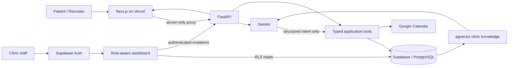

# Marina Smile AI Receptionist

A production-minded dental receptionist and clinic operations platform built
with FastAPI, Next.js, Supabase, Gemini, PostgreSQL/pgvector, and Google
Calendar.

The system deliberately separates language understanding from authoritative
business operations. Gemini extracts intent and generates grounded answers;
typed application services, Supabase policies, PostgreSQL constraints, and
Google Calendar decide what is true and what actions are allowed.

## Live project

| Resource | Link | Status |
| --- | --- | --- |
| Recruiter UI | [Live Vercel site](https://marinasmileai-receptionist.vercel.app) | Verified HTTP 200 on 2026-10-21 |
| Live demo queries | Same site, recruiter demo panel | Vercel proxy and Render backend connected |
| Vercel project | [Deployment project](https://vercel.com/neural-nexus-59b4/marina_smile_ai-receptionist) | Project supplied by owner |
| Source | [GitHub repository](https://github.com/Huzaifa-170504/Marina_Smile_AI-Receptionist) | Public |

The Vercel management URL requires project access and is not presented as the
public demo URL. The recruiter homepage, staff login, aggregate status, and
read-only demo queries respond through the production deployment.

## What the recruiter UI demonstrates

- A public project narrative and architecture overview at `/`
- Live aggregate health data without exposing patient records
- Grounded clinic questions using Supabase pgvector retrieval and Gemini
- Live service, doctor, specialty, and doctor-service directory answers from
  Supabase without asking the model to invent operational facts
- Read-only availability checks against schedules, appointment conflicts, and
  Google Calendar
- Source provenance, normalized errors, and measured request latency
- A separate authenticated, role-aware operations dashboard

Public demo requests pass through a server-only Vercel route. Privileged
Supabase credentials, the Gemini key, Google credentials, and the internal demo
token are never sent to the browser. Queries are validated, clinic-scoped, and
rate-limited through PostgreSQL. The demo cannot book, reschedule, cancel, or
read patient records.

Suggested recruiter checks:

- `Hello` demonstrates concise conversational guidance.
- `What services do you offer?` reads the active service catalogue.
- `Which doctors are available?` lists active doctors and clearly separates
  active records from real appointment availability.
- `Which services are offered by Dr. Sara Haddad?` verifies the live
  many-to-many doctor-service relationship.
- `How much is teeth whitening?` demonstrates PDF retrieval, pgvector source
  scoring, and grounded Gemini generation.
- The Live availability tab demonstrates read-only schedule and Calendar
  conflict checks.

## Architecture



### Trust boundaries

- **Gemini:** language interpretation and grounded response generation
- **FastAPI:** validation, authorization, orchestration, and normalized errors
- **PostgreSQL:** tenant isolation, lifecycle rules, idempotency, concurrency,
  and audit state
- **Google Calendar:** real external availability and event state
- **Next.js:** public recruiter experience and authenticated staff interface

## Implemented capabilities

### AI and retrieval

- Page-aware PDF ingestion with checksums and deterministic chunking
- Gemini Embedding 2 using a fixed 768-dimensional contract
- Clinic-scoped semantic retrieval through Supabase pgvector
- Grounded answers with source filename, page, and similarity
- Fixed fallbacks for unsupported context, prompt injection, availability
  claims, and medication requests
- Structured, bounded Gemini intent extraction for scheduling language

### Scheduling and appointment safety

- Tenant-scoped doctor, service, schedule, and appointment repositories
- Database and Calendar conflict checks
- PostgreSQL exclusion constraints for overlapping active appointments
- `pending -> Calendar event -> confirmed` booking flow
- Idempotent requests and compensating actions for external failures
- Explicit reschedule and cancellation services
- Patient-operation, payment, refund, queue, and audit foundations

### Operations dashboard

- Supabase SSR cookie sessions and protected routes
- Roles sourced from `staff_users`, never browser storage
- Owner, doctor, receptionist, and payment-verifier views
- Appointments, queue, patients, doctors, schedules, payments, staff access,
  handoffs, audit records, and clinic settings
- Supabase Realtime refreshes where operationally useful
- Protected FastAPI mutations for high-impact actions

Booking, rescheduling, and cancellation remain intentionally read-only in the
dashboard until their Python services are adapted to the latest payment-gated
database contract.

## Repository structure

```text
app/                    FastAPI, AI, repositories, integrations, operations
dashboard/              Next.js recruiter site and staff dashboard
docs/database/          Schema, lifecycle, RLS, and ERD documentation
scripts/                Controlled ingestion and operational CLIs
supabase/migrations/    Ordered, reproducible database migrations
supabase/seeds/         Non-sensitive Marina Smile demo seed
supabase/tests/         SQL integrity and authorization tests
tests/                  Python unit and contract tests
render.yaml             Render backend blueprint
```

## Local setup

### Backend

Requirements: Python 3.12 or newer.

```powershell
py -3.12 -m venv venv
.\venv\Scripts\Activate.ps1
pip install -r requirements.txt
Copy-Item .env.example .env
python -m uvicorn app.main:app --reload --port 8000
```

Verify `http://127.0.0.1:8000/health`:

```json
{
  "status": "ok",
  "service": "Marina Smile AI Receptionist"
}
```

### Frontend

Requirements: Node.js 20.9 or newer.

```powershell
Copy-Item dashboard/.env.example dashboard/.env.local
Set-Location dashboard
npm.cmd install
npm.cmd run dev
```

Open `http://localhost:3000` for the recruiter experience or
`http://localhost:3000/login` for the staff portal.

## Environment variables

### FastAPI / Render

| Variable | Purpose |
| --- | --- |
| `SUPABASE_URL` | Exact Supabase project origin |
| `SUPABASE_SECRET_KEY` | Trusted server key; never expose in the browser |
| `GEMINI_API_KEY` | Gemini generation and embedding access |
| `GEMINI_MODEL` | Grounded generation model |
| `GEMINI_EMBEDDING_MODEL` | Must remain `gemini-embedding-2` |
| `GEMINI_EMBEDDING_DIMENSIONS` | Must remain `768` |
| `DEFAULT_CLINIC_ID` | Fixed clinic scope for scripts and public demo |
| `RAG_MATCH_THRESHOLD` | Minimum pgvector similarity accepted for knowledge context |
| `GOOGLE_APPLICATION_CREDENTIALS` | Ignored service-account JSON path |
| `DASHBOARD_ALLOWED_ORIGINS` | Comma-separated trusted frontend origins |
| `DASHBOARD_APPLICATION_URL` | Origin used for Auth email redirects |
| `DEMO_ENABLED` | Enables demo routes after migrations are applied |
| `DEMO_API_TOKEN` | Random server-to-server token, at least 32 characters |
| `DEMO_QUERY_LIMIT` | Per-visitor quota within the configured window |
| `DEMO_QUERY_WINDOW_SECONDS` | Persistent quota window |

### Next.js / Vercel

| Variable | Visibility | Purpose |
| --- | --- | --- |
| `NEXT_PUBLIC_SUPABASE_URL` | Browser | Exact Supabase project origin |
| `NEXT_PUBLIC_SUPABASE_PUBLISHABLE_KEY` | Browser | Publishable, RLS-scoped key |
| `NEXT_PUBLIC_API_BASE_URL` | Browser | FastAPI origin for staff APIs |
| `DEMO_BACKEND_URL` | Server only | FastAPI origin used by demo proxy |
| `DEMO_API_TOKEN` | Server only | Same token configured on FastAPI |
| `DEMO_FINGERPRINT_SECRET` | Server only | HMAC key for anonymous quotas |

Never place the Supabase secret key, Gemini key, Google private key, or demo
server token in a `NEXT_PUBLIC_*` variable.

## Database migrations

Verify the intended Supabase project reference and remote migration history
before applying anything. The latest additive migrations are:

- `20261020083343_patient_operations_coalesce_compatibility.sql` replaces five
  lazily compiled PL/pgSQL functions that incorrectly schema-qualified
  PostgreSQL `COALESCE` syntax.
- `20261020083413_demo_query_rate_limit.sql` adds service-only, RLS-protected,
  database-serialized demo quotas.

Both migrations were applied to Supabase project `lpsjfkyixoubhrryaadk` on
2026-10-20. The repaired functions and quota permissions were inspected live;
an atomic allow/deny quota check was run inside a rolled-back transaction.
Do not edit migrations already recorded remotely. Enable `DEMO_ENABLED` only
after the FastAPI host has its server-only credentials configured.

## Useful commands

### Knowledge assistant

```powershell
python scripts/ingest_pdf.py --clinic-id <clinic-uuid> --pdf <clinic.pdf>
python scripts/test_rag.py
python scripts/ask_knowledge.py
```

### Scheduling tools

```powershell
python scripts/parse_operational_request.py
python scripts/check_availability.py
python scripts/book_appointment.py --help
python scripts/reschedule_appointment.py --help
python scripts/cancel_appointment.py --help
```

Mutation CLIs show a preview and require explicit confirmation. Availability
is advisory; PostgreSQL remains the authoritative concurrency boundary.

## Verification

Backend:

```powershell
pytest
```

Frontend:

```powershell
Set-Location dashboard
npm.cmd test
npm.cmd run lint
npm.cmd run typecheck
npm.cmd run build
```

Unit tests do not prove that hosted credentials, Calendar permissions,
migrations, or deployments work. Those external states are reported separately.

## Deployment

### Vercel

1. Import this GitHub repository.
2. Set the project root directory to `dashboard`.
3. Add the frontend variables listed above.
4. Deploy and copy the responding production URL.
5. Add that HTTPS origin to FastAPI CORS and Supabase Auth redirect URLs.

### Render

1. Create a Blueprint from `render.yaml`.
2. Add server secrets without committing them.
3. Provide Google credentials through a secure Render secret file.
4. Set `DEMO_ENABLED=true` after all server secrets are configured.
5. Set the API origin as `DEMO_BACKEND_URL` and
   `NEXT_PUBLIC_API_BASE_URL` in Vercel.

## Security notes

- All exposed operational tables use RLS and clinic-scoped authorization.
- `service_role`/secret credentials are backend-only.
- Staff roles come from server-controlled records, not user metadata or
  `localStorage`.
- Dynamic clinic facts come from Supabase or Calendar, not model memory.
- External actions are not reported as successful until the provider confirms.
- Demo fingerprints are one-way HMAC values; raw visitor addresses are not
  stored in the application database.
- Secrets, credentials, local PDFs, build output, Vercel state, virtual
  environments, and test artifacts are excluded from Git.

## Current limitations

- WhatsApp/Meta webhook delivery is outside the current repository milestone.
- The public demo depends on a separately hosted FastAPI service; Vercel alone
  does not run the Python backend.
- Dashboard booking/change controls remain disabled until the latest database
  workflow contract is adopted by those endpoints.
- Production Auth email delivery requires configured Supabase SMTP and exact
  redirect allow-lists.

## License

[MIT](LICENSE) © 2026 Huzaifa Waqar.
