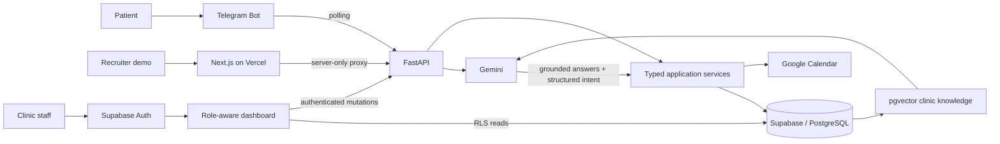

# Marina Smile AI Receptionist

A production-minded dental receptionist and clinic operations platform built
with Telegram, FastAPI, Next.js, Supabase, Gemini, PostgreSQL/pgvector, and
Google Calendar.

Patients use a Telegram bot to register, explore services and doctors, see live
availability, book one or more treatments, manage appointments, check payment
status, and receive reminders. Clinic staff use a role-aware Next.js dashboard
for appointments, queue, patients, payments, schedules, and audit.

The system deliberately separates language understanding from authoritative
business operations. Gemini extracts intent and generates grounded answers;
typed application services, PostgreSQL constraints and RPCs, Supabase policies,
and Google Calendar decide what is true and what actions are allowed.

## Live project

| Resource | Link | Status |
| --- | --- | --- |
| Recruiter UI | [Live Vercel site](https://marinasmileai-receptionist.vercel.app) | Public demo |
| Live demo queries | Same site, recruiter demo panel | Vercel proxy and Render backend connected |
| Vercel project | [Deployment project](https://vercel.com/neural-nexus-59b4/marina_smile_ai-receptionist) | Project supplied by owner |
| Source | [GitHub repository](https://github.com/Huzaifa-170504/Marina_Smile_AI-Receptionist) | Public |

The Vercel management URL requires project access and is not presented as the
public demo URL. The recruiter homepage, staff login, aggregate status, and
read-only demo queries respond through the production deployment.

## Telegram patient workflows

Persistent menu:

1. **Book Appointment**
2. **My Appointments**
3. **Our Doctors**
4. **Dental Services**
5. **Ask Marina AI**
6. **Payments & Pricing**
7. **Help & Contact Reception**

### Booking

1. Patient enters a phone number (international or local format) or email.
2. Existing patients are recognised. New or incomplete patients provide name,
   age, and gender after choosing a slot.
3. Patient selects one or more services.
4. Only doctors qualified for **all** selected services are shown.
5. Live availability is fetched from schedules, existing appointments, and
   Google Calendar. Patients are not asked to type a date.
6. Past and already-booked slots are hidden. Slots freed by a future
   cancellation are shown first.
7. Patient selects a slot and receives a confirmation containing the
   appointment reference, patient ID, name, age, gender, doctor, services,
   date/time, total bill, and payment status.

The current Telegram booking pipeline uses **cash in hand** by default. Online
receipt upload and manual verification remain available in the database/API and
staff dashboard.

### Appointments

- Upcoming, past, and cancelled appointments grouped on one screen.
- Pending booking requests are shown with **Retry** and **Cancel request**.
- Actions: view details, reschedule, cancel one appointment, or cancel the
  linked booking plan.
- Rescheduling searches live slots for the appointment's full service duration.
- Cancellation removes the Calendar event, cancels pending notifications, and
  erases personal identifiers when no other active booking needs them.

### Notifications

| Notification | Timing | Channel |
| --- | --- | --- |
| Booking confirmation | Immediately | Telegram |
| Rescheduling confirmation | Immediately | Telegram |
| Cancellation confirmation | Immediately | Telegram |
| Appointment reminder | 24 hours before | Telegram |
| Final reminder | 2 hours before | Telegram |
| Feedback request | 2 hours after completion | Telegram |

Reminder rules are enforced by database triggers:

- More than 24 hours away → 24-hour and 2-hour reminders.
- Within 24 hours → only the 2-hour reminder.
- Within 2 hours → the 2-hour reminder is sent as soon as possible.
- Rescheduling moves reminders to the new slot.
- Cancelled/no-show appointments receive no further reminders or feedback.
- Completed appointments receive a feedback request two hours later.

Reminder text reports the actual time until the appointment.

### Privacy controls

- Patient lookup and appointment management are bound to the Telegram chat that
  booked the record. A different Telegram account is refused.
- The bot uses a patient-safe table/RPC allowlist. Staff, payroll, refund, and
  audit tables are inaccessible even though the bot uses the service-role key.
- Cancelling a booking anonymises the patient and contact when no other active
  booking requires them, and deletes receipt images.
- AI answers refuse staff salaries/payroll, internal staff data, and another
  patient's records.

## Architecture



### Trust boundaries

- **Gemini:** language interpretation and grounded response generation
- **FastAPI + Telegram bot:** validation, authorization, orchestration, and
  patient-facing workflows
- **PostgreSQL:** tenant isolation, lifecycle rules, idempotency, concurrency,
  notification scheduling, and audit state
- **Google Calendar:** external availability and event state
- **Next.js:** public recruiter experience and authenticated staff interface

## Implemented capabilities

### Scheduling and appointment safety

- Tenant-scoped doctor, service, schedule, and appointment repositories
- Database and Calendar conflict checks
- PostgreSQL exclusion constraints preventing overlapping active appointments
- `pending -> Calendar event -> confirmed` booking flow
- Idempotent requests and compensating actions for external failures
- Multi-service booking with per-service times and a calculated bill
- Live availability search with past and booked slots removed
- Explicit reschedule and cancellation services
- Payment, refund, queue, and audit foundations

### Payments

- Cash-in-hand bookings confirmed as unpaid and settled by staff
- Online receipt upload to private Storage with manual clinic verification
- Payment approval/rejection and cash settlement in the dashboard
- Refund requests, review, payout, and audit foundations

### Notifications

- Immediate booking, rescheduling, and cancellation confirmations
- 24-hour and 2-hour reminders
- Post-completion feedback requests
- Database-authoritative scheduling with automatic cleanup on cancellation
- Telegram delivery worker running inside the API process

### AI and retrieval

- Page-aware PDF ingestion with checksums and deterministic chunking
- Gemini Embedding 2 using a fixed 768-dimensional contract
- Clinic-scoped semantic retrieval through Supabase pgvector
- Grounded answers with source filename, page, and similarity
- Fixed fallbacks for unsupported context, prompt injection, availability
  claims, medication requests, salaries, and cross-patient data
- Structured, bounded Gemini intent extraction for scheduling language

### Operations dashboard

- Supabase SSR cookie sessions and protected routes
- Roles sourced from `staff_users`, never browser storage
- Owner, doctor, receptionist, and payment-verifier views
- Appointments, queue, patients, doctors, schedules, payments, staff access,
  handoffs, audit records, and clinic settings
- Supabase Realtime refreshes where operationally useful
- Protected FastAPI mutations for high-impact actions

Booking and change controls remain intentionally limited in the dashboard; the
Telegram bot is the live patient booking path.

## Repository structure

```text
app/                    FastAPI, AI, repositories, integrations, operations
app/telegram/           Telegram patient bot, notification worker, privacy guard
dashboard/              Next.js recruiter site and staff dashboard
docs/database/          Schema, lifecycle, RLS, and ERD documentation
docs/telegram-bot-deployment.md
scripts/                Controlled ingestion and operational CLIs
supabase/migrations/    Ordered, additive database migrations
supabase/seeds/         Non-sensitive Marina Smile demo seed
supabase/tests/         SQL integrity and authorization tests
tests/                  Python unit and contract tests
render.yaml             Render backend blueprint
CLAUDE.md               Codebase guidance for future Claude Code sessions
```

## Local setup

### Backend

Requirements: Python 3.12 or newer.

```powershell
py -3.12 -m venv venv
.\venv\Scripts\Activate.ps1
pip install -r requirements.txt
Copy-Item .env.example .env
python -m uvicorn app.main:app --reload --port 8000
```

Verify `http://127.0.0.1:8000/health`:

```json
{
  "status": "ok",
  "service": "Marina Smile AI Receptionist"
}
```

If `TELEGRAM_BOT_TOKEN` is set, the same process starts Telegram polling and the
notification worker. If it is unset, the API runs without them.

### Telegram bot

1. Create a bot with BotFather and set `TELEGRAM_BOT_TOKEN`.
2. Start the FastAPI process above.
3. Open a private chat with the bot and send `/start`.
4. Do not run `python -m app.telegram.bot` while the API is polling with the
   same token.

See [docs/telegram-bot-deployment.md](docs/telegram-bot-deployment.md) for
deployment and token details.

### Frontend

Requirements: Node.js 20.9 or newer.

```powershell
Copy-Item dashboard/.env.example dashboard/.env.local
Set-Location dashboard
npm.cmd install
npm.cmd run dev
```

Open `http://localhost:3000` for the recruiter experience or
`http://localhost:3000/login` for the staff portal.

## Environment variables

### FastAPI / Render

| Variable | Purpose |
| --- | --- |
| `SUPABASE_URL` | Exact Supabase project origin |
| `SUPABASE_SECRET_KEY` | Trusted server key; never expose in the browser |
| `TELEGRAM_BOT_TOKEN` | Telegram bot token; enables polling and notifications |
| `GEMINI_API_KEY` | Gemini generation and embedding access |
| `GEMINI_MODEL` | Grounded generation model |
| `GEMINI_EMBEDDING_MODEL` | Must remain `gemini-embedding-2` |
| `GEMINI_EMBEDDING_DIMENSIONS` | Must remain `768` |
| `DEFAULT_CLINIC_ID` | Fixed clinic scope for the bot and scripts |
| `RAG_MATCH_THRESHOLD` | Minimum pgvector similarity accepted for knowledge context |
| `GOOGLE_APPLICATION_CREDENTIALS` | Service-account JSON path used for Calendar |
| `DASHBOARD_ALLOWED_ORIGINS` | Comma-separated trusted frontend origins |
| `DASHBOARD_APPLICATION_URL` | Origin used for Auth email redirects |
| `AVAILABILITY_SEARCH_DAYS` | Number of days searched for live slots |
| `DEMO_ENABLED` | Enables demo routes after migrations are applied |
| `DEMO_API_TOKEN` | Random server-to-server token, at least 32 characters |
| `DEMO_QUERY_LIMIT` | Per-visitor quota within the configured window |
| `DEMO_QUERY_WINDOW_SECONDS` | Persistent quota window |

Google Calendar also requires `clinics.google_calendar_id` to be set and the
calendar to be shared with the service account with **Make changes to events**.

### Next.js / Vercel

| Variable | Visibility | Purpose |
| --- | --- | --- |
| `NEXT_PUBLIC_SUPABASE_URL` | Browser | Exact Supabase project origin |
| `NEXT_PUBLIC_SUPABASE_PUBLISHABLE_KEY` | Browser | Publishable, RLS-scoped key |
| `NEXT_PUBLIC_API_BASE_URL` | Browser | FastAPI origin for staff APIs |
| `DEMO_BACKEND_URL` | Server only | FastAPI origin used by demo proxy |
| `DEMO_API_TOKEN` | Server only | Same token configured on FastAPI |
| `DEMO_FINGERPRINT_SECRET` | Server only | HMAC key for anonymous quotas |

Never place the Supabase secret key, Gemini key, Google private key, Telegram
token, or demo server token in a `NEXT_PUBLIC_*` variable.

## Database migrations

There is no Supabase CLI configuration in the repository. Apply migrations
**manually in the Supabase SQL editor**, in filename order. Every file is wrapped
in `begin; ... commit;`.

- `0001`–`0016` are the canonical base.
- Timestamped files are additive releases. Never edit a migration that has
  already been applied; add a new timestamped file.
- The live database may differ from the canonical files. When a write fails with
  `23514` (check) or `23502` (not null), inspect the live constraint and
  reconcile it with a new migration.

Recent additive migrations include:

- `20261020083343_patient_operations_coalesce_compatibility.sql`
- `20261020083413_demo_query_rate_limit.sql`
- `20261106104639_add_patient_email_for_telegram.sql`
- `20261106150000_complete_patient_booking_workflow.sql`
- `20261106180000_per_service_schedule.sql`
- `20261106190000_reconcile_patient_identity_requirements.sql`
- `20261109120000_allow_booking_plan_cancellation.sql`
- `20261109130000_drop_legacy_appointment_payment_gate.sql`
- `20261109140000_cancel_booking_privacy_cleanup.sql`
- `20261109150000_fix_appointment_audit_trigger_security.sql`
- `20261109160000_allow_multiple_contacts_per_telegram.sql`
- `20261109170000_feedback_notification_trigger.sql`
- `20261109180000_appointment_notification_scheduler.sql`
- `20261109190000_reminder_timing_rules.sql`

`supabase/tests/README.md` describes the SQL integrity/RLS suite. It requires a
disposable project and is not run by `pytest`.

## Useful commands

### Knowledge assistant

```powershell
python scripts/ingest_pdf.py --clinic-id <clinic-uuid> --pdf <clinic.pdf>
python scripts/test_rag.py
python scripts/ask_knowledge.py
```

### Scheduling tools

```powershell
python scripts/parse_operational_request.py
python scripts/check_availability.py
python scripts/book_appointment.py --help
python scripts/reschedule_appointment.py --help
python scripts/cancel_appointment.py --help
```

Mutation CLIs show a preview and require explicit confirmation. Availability is
advisory; PostgreSQL remains the authoritative concurrency boundary.

## Verification

Backend:

```powershell
.\venv\Scripts\python.exe -m pytest -q
```

Frontend:

```powershell
Set-Location dashboard
npm.cmd test
npm.cmd run lint
npm.cmd run typecheck
npm.cmd run build
```

Current suites: **244 backend tests** and **27 dashboard tests**. Unit tests do
not prove hosted credentials, Calendar permissions, migrations, Telegram
polling, or deployments work; verify those separately.

## Deployment

### Vercel

1. Import this GitHub repository.
2. Set the project root directory to `dashboard`.
3. Add the frontend variables listed above.
4. Deploy and copy the responding production URL.
5. Add that HTTPS origin to FastAPI CORS and Supabase Auth redirect URLs.

### Render

1. Create a Blueprint from `render.yaml`.
2. Add server secrets without committing them, including `TELEGRAM_BOT_TOKEN`.
3. Provide Google credentials through a Render secret file at
   `/etc/secrets/google-service-account.json`.
4. Set `DEMO_ENABLED=true` after all server secrets are configured.
5. Set the API origin as `DEMO_BACKEND_URL` and `NEXT_PUBLIC_API_BASE_URL` in
   Vercel.

Telegram polling and the notification worker start automatically inside the
Render web process when `TELEGRAM_BOT_TOKEN` is present. Reminders depend on that
process staying up.

## Security notes

- All exposed operational tables use RLS and clinic-scoped authorization.
- `service_role`/secret credentials are backend-only.
- The Telegram bot uses a patient-safe allowlist and cannot read staff, payroll,
  refund, or audit tables.
- Patient lookups are bound to the linked Telegram chat.
- Cancelled bookings erase personal identifiers when no other active booking
  requires them; non-identifying audit and financial records are retained.
- Staff roles come from server-controlled records, not user metadata or
  `localStorage`.
- Dynamic clinic facts come from Supabase or Calendar, not model memory.
- External actions are not reported as successful until the provider confirms.
- Demo fingerprints are one-way HMAC values; raw visitor addresses are not
  stored in the application database.
- Secrets, credentials, local PDFs, build output, Vercel state, virtual
  environments, and test artifacts are excluded from Git.

## Current limitations

- WhatsApp/Meta webhook delivery is outside the current repository milestone.
- The public demo depends on a separately hosted FastAPI service; Vercel alone
  does not run the Python backend.
- Multi-doctor/multi-visit booking plans, combination ranking, and partial
  booking consent are not implemented.
- Temporary slot holds, waiting lists, attendance confirmation, reception
  no-show review, and repeat-no-show policies are not implemented.
- Per-service cancellation inside one multi-service appointment is not safe yet;
  cancellation acts on the appointment/plan.
- Telegram conversation state is in memory; the existing
  `conversations.workflow_*` columns are unused.
- Booking actions are not exposed as AI tool calls; Gemini handles grounded
  answers and intent only.
- Production Auth email delivery requires configured Supabase SMTP and exact
  redirect allow-lists.

## License

[MIT](LICENSE) © 2026 Huzaifa Waqar.
