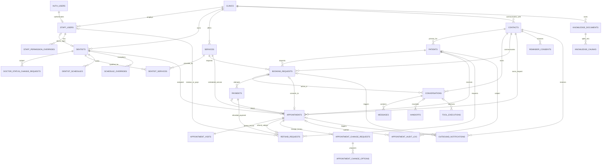

# Entity relationship diagram

`AUTH_USERS` is `auth.users`, managed by Supabase Auth. Storage objects live in
the Supabase `storage` schema and are linked to tenant/workflow records by their
private object path rather than a public foreign key.
